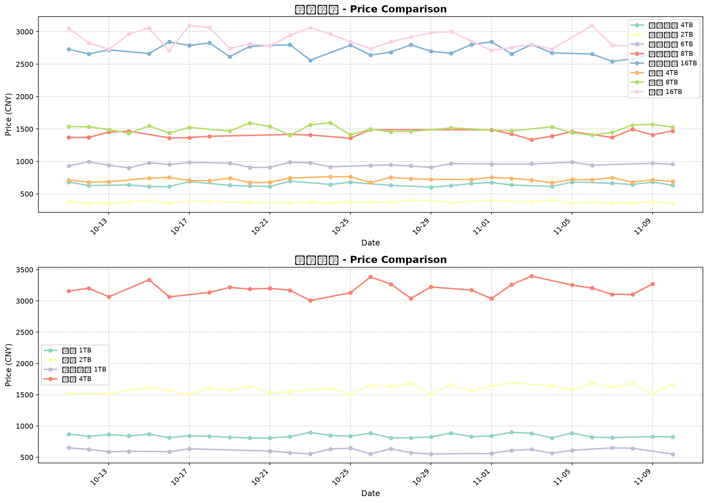
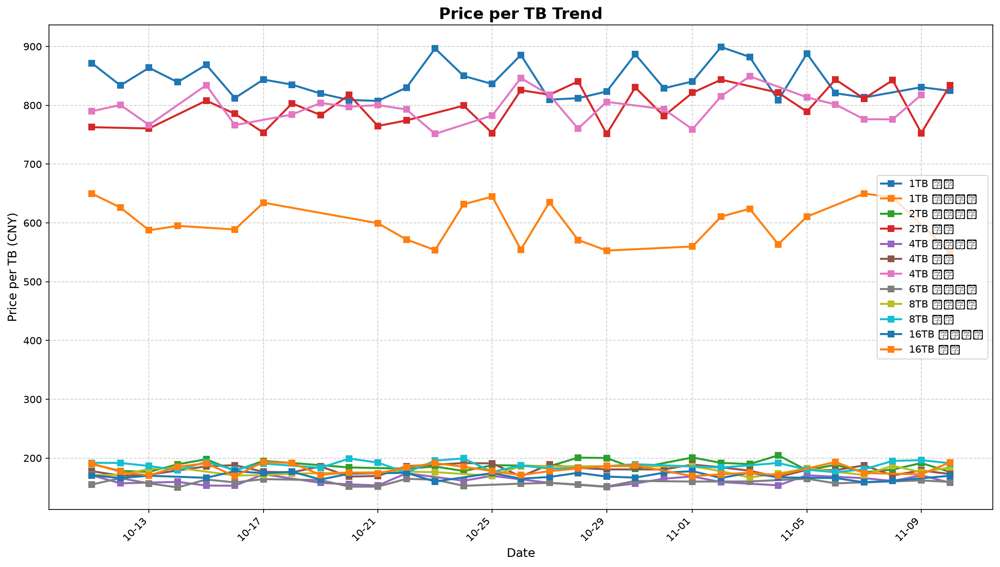

# 京东硬盘价格监控

## 最新价格 (2026-11-10)

**数据来源**: 模拟数据（京东有反爬机制，需要接入真实 API）

### 机械硬盘

| 产品 | 容量 | 当前价格 | 原价 | 优惠 | 状态 |
|------|------|----------|------|------|------|
| [西部数据(Western Digital) 4TB 蓝盘](https://item.jd.com/100012043938.html) | 4TB | ¥632.85 | ~~¥754.33~~ | - | ✅ 有货 |
| [西部数据(Western Digital) 2TB 蓝盘](https://item.jd.com/100008915038.html) | 2TB | ¥352.98 | ~~¥427.35~~ | - | ✅ 有货 |
| [西部数据(Western Digital) 6TB 蓝盘](https://item.jd.com/100012043934.html) | 6TB | ¥956.70 | ~~¥1122.09~~ | - | ✅ 有货 |
| [西部数据(Western Digital) 8TB 蓝盘](https://item.jd.com/100098264478.html) | 8TB | ¥1472.60 | - | - | ✅ 有货 |
| [西部数据(Western Digital) 16TB 蓝盘](https://item.jd.com/100012345678.html) | 16TB | ¥2717.84 | ~~¥3248.63~~ | - | ✅ 有货 |
| [希捷(Seagate) 4TB 酷鹰监控级](https://item.jd.com/100008915050.html) | 4TB | ¥691.17 | - | 券¥22 | ✅ 有货 |
| [希捷(Seagate) 8TB 酷鹰监控级](https://item.jd.com/100098264479.html) | 8TB | ¥1529.60 | ~~¥1891.29~~ | - | ✅ 有货 |
| [希捷(Seagate) 16TB 酷鹰监控级](https://item.jd.com/100012345679.html) | 16TB | ¥3081.02 | ~~¥3531.85~~ | - | ✅ 有货 |

### 固态硬盘

| 产品 | 容量 | 当前价格 | 原价 | 优惠 | 状态 |
|------|------|----------|------|------|------|
| [三星(SAMSUNG) 1TB SSD 970 EVO Plus](https://item.jd.com/100012043960.html) | 1TB | ¥824.71 | - | - | ✅ 有货 |
| [三星(SAMSUNG) 2TB SSD 970 EVO Plus](https://item.jd.com/100012043962.html) | 2TB | ¥1667.25 | - | - | ✅ 有货 |
| [西部数据(Western Digital) 1TB SSD Blue SN570](https://item.jd.com/100012043980.html) | 1TB | ¥550.21 | - | 券¥47 闪购特价 | ✅ 有货 |
| [三星(SAMSUNG) 4TB SSD 870 EVO](https://item.jd.com/100098264480.html) | 4TB | - | - | - | ❌ 缺货 |

---

## 📈 价格趋势图

### 产品价格对比

### 每TB价格趋势

### 单独产品历史价格

查看 [charts/](./charts/) 目录获取每个产品的详细价格曲线图。

---

## 历史价格数据

查看 [data/](./data/) 目录获取历史价格 JSON 数据。

---

*最后更新: 2026-11-10 07:39:12*