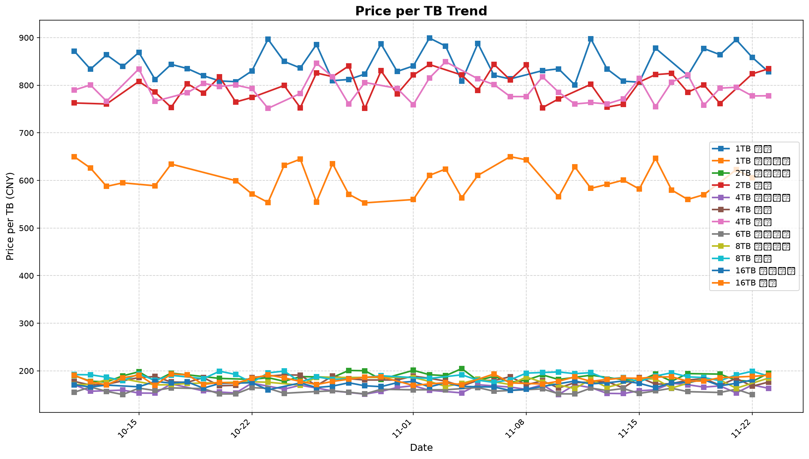

# 京东硬盘价格监控

## 最新价格 (2026-11-15)

**数据来源**: 模拟数据（京东有反爬机制，需要接入真实 API）

### 机械硬盘

| 产品 | 容量 | 当前价格 | 原价 | 优惠 | 状态 |
|------|------|----------|------|------|------|
| [西部数据(Western Digital) 4TB 蓝盘](https://item.jd.com/100012043938.html) | 4TB | ¥632.23 | ~~¥729.20~~ | 会员专享价 | ✅ 有货 |
| [西部数据(Western Digital) 2TB 蓝盘](https://item.jd.com/100008915038.html) | 2TB | ¥357.68 | ~~¥394.71~~ | - | ✅ 有货 |
| [西部数据(Western Digital) 6TB 蓝盘](https://item.jd.com/100012043934.html) | 6TB | ¥915.34 | ~~¥1108.54~~ | - | ✅ 有货 |
| [西部数据(Western Digital) 8TB 蓝盘](https://item.jd.com/100098264478.html) | 8TB | ¥1463.91 | - | - | ✅ 有货 |
| [西部数据(Western Digital) 16TB 蓝盘](https://item.jd.com/100012345678.html) | 16TB | ¥2778.87 | - | 闪购特价 | ✅ 有货 |
| [希捷(Seagate) 4TB 酷鹰监控级](https://item.jd.com/100008915050.html) | 4TB | ¥744.72 | - | - | ✅ 有货 |
| [希捷(Seagate) 8TB 酷鹰监控级](https://item.jd.com/100098264479.html) | 8TB | ¥1418.35 | - | 满减活动 | ✅ 有货 |
| [希捷(Seagate) 16TB 酷鹰监控级](https://item.jd.com/100012345679.html) | 16TB | ¥2948.58 | - | - | ✅ 有货 |

### 固态硬盘

| 产品 | 容量 | 当前价格 | 原价 | 优惠 | 状态 |
|------|------|----------|------|------|------|
| [三星(SAMSUNG) 1TB SSD 970 EVO Plus](https://item.jd.com/100012043960.html) | 1TB | ¥806.41 | - | - | ✅ 有货 |
| [三星(SAMSUNG) 2TB SSD 970 EVO Plus](https://item.jd.com/100012043962.html) | 2TB | ¥1613.36 | ~~¥1889.38~~ | - | ✅ 有货 |
| [西部数据(Western Digital) 1TB SSD Blue SN570](https://item.jd.com/100012043980.html) | 1TB | ¥581.92 | ~~¥735.98~~ | 券¥15 | ✅ 有货 |
| [三星(SAMSUNG) 4TB SSD 870 EVO](https://item.jd.com/100098264480.html) | 4TB | ¥3257.50 | ~~¥3666.26~~ | 券¥43 | ✅ 有货 |

---

## 📈 价格趋势图

### 产品价格对比

### 每TB价格趋势

### 单独产品历史价格

查看 [charts/](./charts/) 目录获取每个产品的详细价格曲线图。

---

## 历史价格数据

查看 [data/](./data/) 目录获取历史价格 JSON 数据。

---

*最后更新: 2026-11-15 18:27:57*